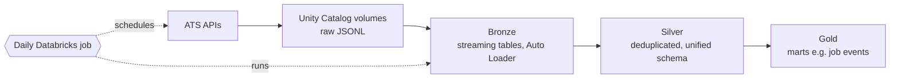
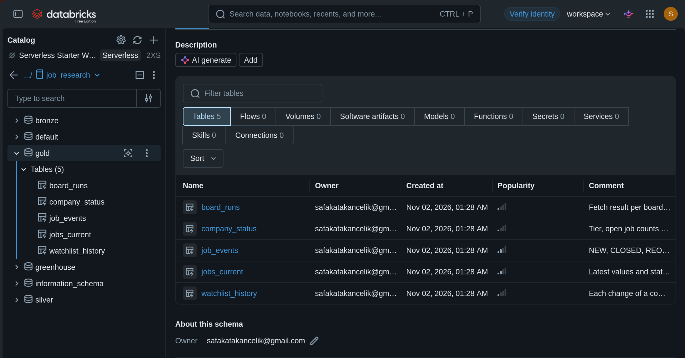
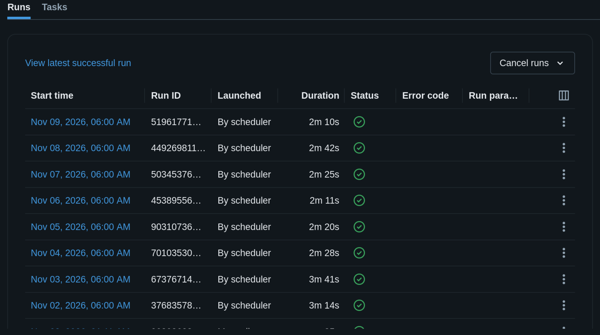
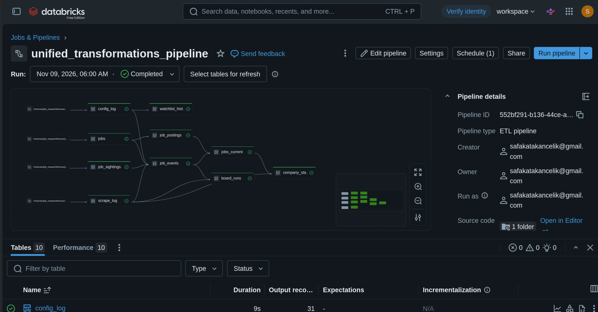
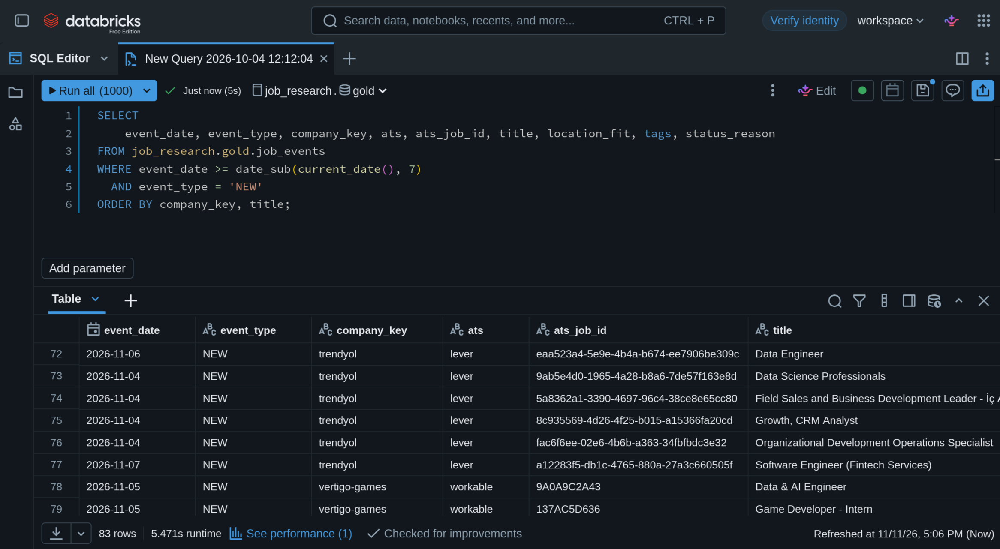

# Job Market Data Warehouse

A data warehouse of job listings on Databricks Free Edition, built to support a targeted job search (Data / BI / Product analyst roles).

## What it does

A scheduled Databricks job runs every day. It pulls open postings from public ATS job-board APIs (e.g. Greenhouse, Lever, Ashby) for a watchlist of companies. It keeps a deduplicated history of every listing, including when it was first seen and when it was last seen, so new and closed postings can be queried by date.

## Architecture

## Screenshots

**1. Catalog.** The `job_research` catalog with bronze, silver and gold schemas. Gold holds five tables: `board_runs`, `company_status`, `job_events`, `jobs_current`, `watchlist_history`.

**2. Recent runs.** The job runs every day at 06:00 and every run shown succeeded, in about 2 to 4 minutes.

**3. Pipeline DAG.** The unified transformations pipeline: raw volume files feed `config_log`, `jobs`, `job_sightings` and `scrape_log`, which feed `job_postings` of silver layer and `watchlist_history`, `job_events`, `jobs_current`, `board_runs` and `company_status` of gold layer. The last run completed with no errors.

**4. New jobs, last 7 days.** A SQL query on `gold.job_events` returns the postings first seen in the last 7 days (83 rows).

## Stack

Databricks (Jobs, Lakeflow/DLT pipelines, Auto Loader, Unity Catalog volumes), SQL, Python, public ATS APIs.

## Design choices

- **First and last seen:** Each posting is deduplicated by its ID and keeps the dates it first and last appeared. That gives the open and close history without storing every snapshot in silver.
- **One unified schema:** Every board is mapped into the same columns, so downstream tables do not care which ATS a job came from.
- **Cross-board `job_key`:** The same job on several boards stays as separate rows, linked by a key built from company and normalised title. Duplicates are linked, not deleted.
- **Filter early:** The unified flow filters postings by a profile in bronze.
- **Quota restrictions:** Over 30 days, interactive notebooks and the SQL warehouse used most of the compute (about $18 of about $24 equivalent); the scheduled job used about $0.07. Fixes applied: detach compute when idle, keep ad-hoc queries few, narrow the company lists, filter early. Costs remained within free tier after fixes.

## Notes
- I plan to integrate this into an application I'm building and using currently, and make use of the information for follow-ups and new applications.
- The actual repository is private, but I'm open to showcasing and sharing it on request.
